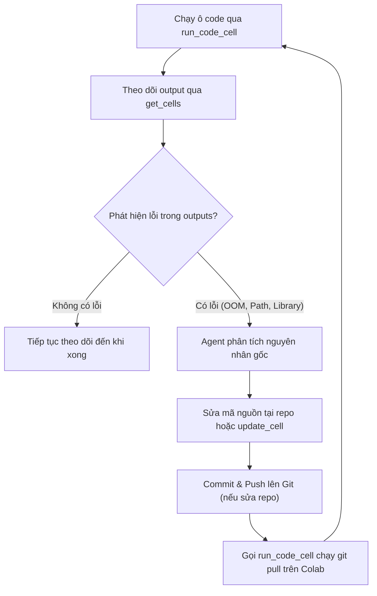

# Colab Bridge Automation Skill

Kỹ năng điều khiển tự động hóa hoàn toàn hai chiều giữa Agent và Google Colab thông qua giao thức MCP (Model Context Protocol), bao gồm vòng lặp tự sửa lỗi (Self-Healing) và chuỗi chuyển tiếp tự động sang bước render hoàn thiện (Pipeline Chaining).

---

## 1. Kiến trúc Cầu nối (MCP WebSocket Bridge)

Colab kết nối với Agent cục bộ thông qua WebSocket server tuân thủ giao thức FastMCP.
- **Port:** Cố định (ví dụ `63171`) để tab Colab tự động tái kết nối khi reload mà không đổi cổng.
- **Token:** `secrets.token_urlsafe(16)` hoặc token phiên cố định trong suốt quá trình chạy.
- **URL kích hoạt:**
  ```text
  https://colab.research.google.com/drive/<notebook_id>?authuser=1#mcpProxyToken=<token>&mcpProxyPort=<port>
  ```
- **Chế độ chạy:** Daemon nền với thời gian chờ bền bỉ (`timeout >= 3600s`).

---

## 2. Đặc tả Công cụ Colab MCP (Tool Schemas)

Google Colab Frontend cung cấp 7 công cụ điều khiển sổ tay. Dưới đây là tham số chuẩn xác:

### 1. `add_code_cell`
Thêm một ô code tại vị trí chỉ định.
```json
{
  "cellIndex": 0,
  "language": "python",
  "code": "!pip install diffusers"
}
```
*Trả về:* `{"newCellId": "<string_id>"}`.

### 2. `run_code_cell`
Kích hoạt chạy ô code bằng `cellId`.
```json
{
  "cellId": "<string_id>"
}
```
*Trả về:* Output hoặc kết quả thực thi của ô code.

### 3. `get_cells`
Đọc danh sách và trạng thái toàn bộ ô code.
```json
{
  "includeOutputs": true
}
```
*Trả về:* Mảng `cells` chứa `id`, `source`, `outputs` (dùng để trích xuất log và phát hiện lỗi).

### 4. `update_cell`
Cập nhật nội dung một ô code đã tồn tại.
```json
{
  "cellId": "<string_id>",
  "content": "# Code mới sửa lỗi..."
}
```

### 5. `delete_cell`
Xóa ô code theo ID.
```json
{
  "cellId": "<string_id>"
}
```

---

## 3. Vòng lặp Tự sửa lỗi (Self-Healing Loop)

Khi thực thi trên Colab, Agent theo dõi `get_cells(includeOutputs=True)` mỗi 15-20 giây. Khi phát hiện lỗi:



### Các mẫu lỗi kinh điển & Cách tự sửa:
1. **Lỗi đường dẫn tuyệt đối (`D:\...`):**
   - Đổi toàn bộ đường dẫn trong `jobs/pending/*.json` sang relative POSIX (`runs/<slug>/media/<name>.jpg`).
2. **Lỗi thiếu file ảnh nguồn:**
   - Kiểm tra `.gitignore`. Thêm ngoại lệ `!runs/<slug>/media/*.jpg` và `git add -f` rồi push.
3. **Lỗi `'NoneType' object has no attribute 'dtype'`:**
   - Gắn `MockTextEncoder` và `MockTokenizer` vào pipeline trước khi chạy suy luận.

---

## 4. Chuỗi chuyển tiếp Tự động (Pipeline Chaining)

Khi Colab hoàn thành toàn bộ các shot (nhận diện qua cờ `🏁 WORKER ĐÃ HOÀN TẤT` trong output):

1. **Bơm ô code nén và kích hoạt tải về máy:**
   ```python
   !zip -r -j /content/<slug>-done.zip /content/Create-Video/jobs/done/<slug>/
   from google.colab import files
   files.download('/content/<slug>-done.zip')
   ```
2. **Giám sát thư mục tải về cục bộ:**
   - Theo dõi thư mục `Downloads` của người dùng để đón file `<slug>-done.zip`.
3. **Tự động giải nén & Chuyển giao Remotion:**
   - Giải nén toàn bộ clip vào `jobs/done/<slug>/`.
   - Tự động thực thi lệnh:
     ```bash
     npx tsx scripts/upgrade_auto.ts "<slug>"
     ```
   - Kịch bản sẽ tự động upscale Lanczos 1080p, đồng bộ 30fps, cân bằng âm thanh `-18 LUFS`, render Remotion master và chạy bộ 3 cổng kiểm định QA tự động.
