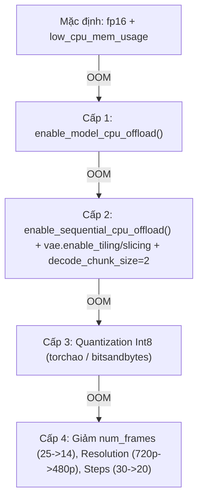

# Colab GPU Guard

Quy chuẩn kỹ thuật bắt buộc để triển khai các mô hình Diffusion sinh video/ảnh (SVD, CogVideoX, LTX-Video, Wan, Hunyuan...) trên Google Colab Free Tier (**NVIDIA Tesla T4 14.56 GiB VRAM, 12.7 GiB System RAM**) an toàn 100%, không bao giờ crash OOM và bảo toàn dữ liệu vĩnh viễn.

---

## 1. Nguyên tắc 10 Điều Răn (Colab 10-Guard Mandates)

Mọi pipeline chạy trên Colab bắt buộc phải thỏa mãn 10 điều kiện kiến trúc sau:

### Điều 1: Ước lượng trước (Pre-planning via hf-mem)
- Trước khi chọn mô hình, phải tra cứu dung lượng bộ nhớ tĩnh và KV cache bằng tool `hf-mem` hoặc Model Card:
  ```bash
  uvx hf-mem --model-id <model-id> --json-output
  ```
- Ghi kết quả vào `docs/memory-plan.md`.
- **Ngưỡng an toàn 80%:**
  - VRAM ước tính $> 11.6\text{ GB}$ (80% của 14.56 GB) $\rightarrow$ **Cấm nạp thẳng**, bắt buộc dùng bản lượng tử hóa (`int8`/`int4`) hoặc kích hoạt CPU Offload.
  - RAM ước tính $> 10.1\text{ GB}$ (80% của 12.7 GB) $\rightarrow$ Phải dùng `low_cpu_mem_usage=True` và chia nhỏ file weight.

### Điều 2: Kiểm tra tiền khả thi mỗi shot (Preflight Check)
Trước khi bắt đầu bất kỳ shot nào, kiểm tra tài nguyên khả dụng thời gian thực:
```python
import torch
import psutil

free_vram_gb = torch.cuda.mem_get_info()[0] / (1024 ** 3)
avail_ram_gb = psutil.virtual_memory().available / (1024 ** 3)

# Ngưỡng an toàn tối thiểu: 2.0GB VRAM, 2.5GB RAM
if free_vram_gb < 2.0 or avail_ram_gb < 2.5:
    raise RuntimeError(f"Tài nguyên dưới ngưỡng an toàn (Free VRAM: {free_vram_gb:.2f}GB, Avail RAM: {avail_ram_gb:.2f}GB). Dừng gọn!")
```

### Điều 3: Thang cấu hình chống OOM 4 cấp độ (Memory Fallback Ladder)
Khi gặp lỗi hoặc điều chỉnh bộ nhớ, áp dụng tuần tự từng nấc thang cấu hình (không crash ngang, ghi log cấu hình thành công):



### Điều 4: Kiểm soát RAM chính (System RAM Shield)
- Luôn truyền `low_cpu_mem_usage=True` khi gọi `from_pretrained(...)`.
- Nếu mô hình có Text Encoder khổng lồ (như T5-XXL 9.5GB): Mã hóa toàn bộ text prompt trước, lưu `prompt_embeds` ra file/RAM, giải phóng text encoder (`del pipe.text_encoder; gc.collect(); torch.cuda.empty_cache()`) rồi mới nạp Transformer vào GPU.
- Tuyệt đối không lưu danh sách mảng khung hình lớn trong bộ nhớ; xuất trực tiếp thành `.mp4` hoặc stream ghi đĩa.

### Điều 5: Cách ly tiến trình con (Subprocess Isolation per Shot)
Hệ điều hành Linux trên Colab chỉ thu hồi 100% rác bộ nhớ C++/CUDA khi một tiến trình kết thúc.
- Mỗi shot phải được thực thi trong một `subprocess.Popen` hoặc hàm phân lập riêng.
- Trong Python:
  ```python
  del pipe
  gc.collect()
  torch.cuda.empty_cache()
  if hasattr(torch.cuda, "ipc_collect"):
      torch.cuda.ipc_collect()
  ```
- Luôn đặt biến môi trường ngay đầu tiến trình:
  ```python
  import os
  os.environ["PYTORCH_CUDA_ALLOC_CONF"] = "expandable_segments:True"
  ```

### Điều 6: Bắt ngoại lệ OOM và tự động hạ bậc (Auto-healing Loop)
Bọc khối suy luận trong khối xử lý ngoại lệ:
- Bắt `torch.cuda.OutOfMemoryError`.
- Khi OOM: dọn sạch VRAM, hạ bậc cấu hình theo Thang điều 3 (tối đa 3 lần thử).
- Nếu sau 3 lần vẫn thất bại: Đánh dấu shot `failed` trong manifest/queue, ghi rõ nguyên nhân và tự động chạy tiếp shot sau, không làm dừng toàn bộ pipeline 12 shot.

### Điều 7: Độ bền dữ liệu (Persistence & Google Drive)
Không bao giờ để dữ liệu đầu ra chỉ nằm trong thư mục tạm `/content/` (mất trắng khi Colab disconnect):
```python
from google.colab import drive
import shutil
from pathlib import Path

# Mount Google Drive
drive.mount('/content/drive')
drive_out = Path('/content/drive/MyDrive/Create-Video-Outputs')
drive_out.mkdir(parents=True, exist_ok=True)

# Sau mỗi shot: sao chép ngay lập tức sang Drive
shutil.copy2(local_clip_path, drive_out / local_clip_path.name)
```
- **Cơ chế Checkpointing/Resume:** Kiểm tra file đích trước khi sinh:
  ```python
  if target_clip.exists() and target_clip.stat().st_size > 1024 * 1024:
      print(f"✨ Shot {shot_id} đã có file hợp lệ, bỏ qua.")
      continue
  ```

### Điều 8: Nhật ký bộ nhớ thời gian thực (`memory_log.csv`)
Ghi nhật ký mỗi shot vào `runs/<slug>/memory_log.csv`:
```csv
shot_id,timestamp,peak_vram_gb,peak_ram_gb,duration_sec,config_level,status,model
shot_01,2026-10-16T16:00:00Z,5.42,4.81,42.5,Level_1,SUCCESS,svd-xt
```
- Đo peak VRAM bằng: `torch.cuda.max_memory_allocated() / (1024 ** 3)`.
- Reset peak đo đạc sau mỗi shot: `torch.cuda.reset_peak_memory_stats()`.

### Điều 9: Ghim phiên bản và chọn dtype chuẩn xác
- Ghim file phụ thuộc `notebooks/requirements-colab.txt`:
  ```text
  torch>=2.4.0
  diffusers>=0.31.0
  transformers>=4.45.0
  accelerate>=0.34.0
  imageio[ffmpeg]
  torchao>=0.5.0
  ```
- **Kiểm tra phần cứng để chọn kiểu dữ liệu:**
  ```python
  dtype = torch.bfloat16 if torch.cuda.is_bf16_supported() else torch.float16
  # Tesla T4 (Turing CC 7.5) -> bắt buộc float16
  # A100 / L4 (Ampere/Ada) -> chọn bfloat16
  ```
- **Chạy thử Pilot (1 clip duy nhất)** trước khi bấm chạy hàng loạt cả 12 clip.

### Điều 10: Quy tắc bất biến (Immutability Rule)
Tuyệt đối không đổi mô hình hoặc tăng độ phân giải/số khung hình khi chưa có kết quả `memory_log.csv` đạt chuẩn an toàn từ clip thử nghiệm.

---

## 2. Thư viện triển khai mẫu (Reference Implementation)

Xem chi tiết code mẫu chuẩn mực trong các tài liệu tham khảo đính kèm:
* [Thang cấu hình chống OOM chi tiết](file:///d:/project/Create-Video/.agent/skills/colab-gpu-guard/references/memory_ladder.md)
* [Script mẫu Preflight & Memory Monitor](file:///d:/project/Create-Video/.agent/skills/colab-gpu-guard/references/preflight_template.py)
* [Script mẫu Mount Drive & Auto-resume](file:///d:/project/Create-Video/.agent/skills/colab-gpu-guard/references/drive_persistence.py)
