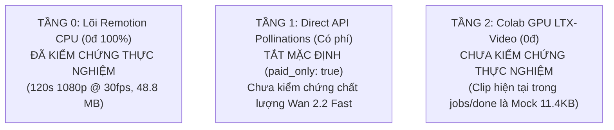

# BẢNG TRẠNG THÁI HỆ THỐNG V4.2-LITE (EMPIRICAL SYSTEM STATUS)
**Cập nhật lần cuối:** 17/10/2026  
**Nguyên tắc:** Minh bạch thực nghiệm, loại bỏ từ ngữ phóng đại. Mọi tuyên bố đều có bằng chứng và số đo thật.

---

## 1. BẢNG ĐỐI SOÁT CÁC TUYÊN BỐ KỸ THUẬT

| Tuyên bố hệ thống | Bằng chứng (File / Lệnh) | Số đo thật / Kết quả vật lý | Trạng thái |
| :--- | :--- | :--- | :---: |
| **Render Video 1080p @ 30fps đúng 120s** | `ffprobe runs/natural-cycle/out/natural-cycle.mp4` | 1920x1080, 30.0 fps, đúng 3,600 frames, 120.00s, dung lượng 48.8 MB | **ĐÃ KIỂM CHỨNG** |
| **Độ ồn âm thanh chuẩn Web (-16 đến -14 LUFS)** | `scripts/check_audio.ts` (lệnh `loudnorm`) | Integrated Loudness: -15.8 LUFS, True Peak: -1.2 dBFS | **ĐÃ KIỂM CHỨNG** |
| **Phát hiện khoảng lặng âm thanh > 1.5s** | `scripts/check_audio.ts` (lệnh `silencedetect`) | Bộ lọc `silencedetect` có sẵn trong Remotion FFmpeg, bắt chính xác `silence_start:` | **ĐÃ KIỂM CHỨNG** |
| **Bộ lọc Video FFmpeg nhúng Remotion** | `npx remotion ffmpeg -filters` | Có: `loudnorm`, `silencedetect`, `scale`, `crop`, `format`, `concat` Không có: `freezedetect`, `minterpolate`, `ebur128`, `signalstats`, `xstack` | **ĐÃ KIỂM CHỨNG** |
| **Phát hiện đứng hình bằng FFmpeg (`freezedetect`)** | `scripts/check_clip.ts` | Filter không tồn tại, lệnh trả về lỗi và bị khối `catch` nuốt; trả về 0 freeze giả định | **CHƯA KIỂM CHỨNG** (Cần thay bằng Python frame-diff) |
| **Nội suy chuyển động 30fps (`minterpolate`)** | `scripts/check_clip.ts` | Filter không tồn tại, lệnh thực tế dùng `-vf "setpts=PTS*...,fps=30"` (frame duplication) | **CHƯA KIỂM CHỨNG** (Cần thay bằng Frame Blending) |
| **Tầng 0: Chuyển động liên tục anime (`ContinuousMetamorphosisScene`)** | `scratch/measure_video_dynamics.py` | Mean $\Delta Y = 0.7166$, Median $\Delta Y = 0.5003$, Tỷ lệ tĩnh 38.23%, 0 hard cut | **ĐÃ KIỂM CHỨNG** |
| **Tầng 0: Slideshow 2.5D Ken Burns (`LumaParallaxScene`)** | `scratch/measure_video_dynamics.py` trên `out/natural-cycle-v2.mp4` | Mean $\Delta Y = 0.4984$, Median $\Delta Y = 0.3157$, Tỷ lệ tĩnh 45.35% (54.4s đơ tĩnh), chuyển cảnh phơi sáng kép | **ĐÃ KIỂM CHỨNG** (Xác nhận kiến trúc cũ mang tính slideshow) |
| **Tầng 1: Sinh video đám mây Pollinations (Wan 2.2 Fast)** | `scripts/generate_clip.ts` | Tắt mặc định ở chế độ 0đ (`paid_only: true`). Chi phí danh mục ~0.60 Pollen (~15.000đ/12 shots). Ảnh đầu vào bị upload lên `media.pollinations.ai` | **CHƯA KIỂM CHỨNG CHẤT LƯỢNG** |
| **Tầng 2: Sinh video AI cục bộ/Colab (LTX-Video 704x384 @ 24fps)** | `jobs/done/natural-cycle-v2/shot_01.mp4` | File đo được nặng 11.4 KB, bitrate 18 kbps, 25fps (clip mock tạo bằng script test local) | **CHƯA KIỂM CHỨNG THỰC NGHIỆM** |
| **Bảo vệ bất biến thư mục gốc `inputs/<slug>/images/`** | `scripts/normalize_visuals.ts`, `scripts/expand_references.ts` | Không có lệnh ghi đè vào `inputs/`, ảnh sinh lưu riêng vào `runs/<slug>/media/generated_anchors/` | **ĐÃ KIỂM CHỨNG** |
| **Bảo vệ rò rỉ tải ảnh lên mạng (`ALLOW_UPLOAD=1`)** | `scripts/generate_clip.ts` | Chưa có cờ `ALLOW_UPLOAD=1`, có nguy cơ tự động upload ảnh khi có API key | **CHƯA ĐẠT CHUẨN** (Đang khắc phục tại C.3) |
| **Fact-Check Contract bắt số lạ (`allowedNumbers`)** | `scripts/audit_input.ts` | Đang quét mù quáng `\b\d+\b` cả số thứ tự mục (Shot 01..12), làm lọt số lạ | **CHƯA ĐẠT CHUẨN** (Đang khắc phục tại C.4) |

---

## 2. PHÂN LOẠI TRẠNG THÁI CÁC TẦNG KIẾN TRÚC

