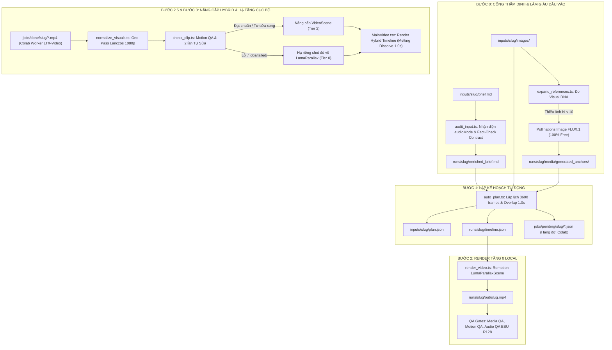

# HƯỚNG DẪN VẬN HÀNH AUTO MODE V4.1 (NHÀ MÁY SẢN XUẤT VIDEO TỰ ĐỘNG)

## 1. Giới thiệu tổng quan
**AUTO MODE V4.1** là kiến trúc vận hành tự động toàn diện của nhà máy sản xuất video Remotion. Chỉ với **MỘT lệnh duy nhất**, hệ thống sẽ xử lý từ tài liệu brief và tập ảnh đầu vào đến file MP4 hoàn chỉnh 1080p xuất xưởng, **hoàn toàn không có điểm dừng chờ duyệt thủ công**.

Phiên bản **V4.1** bổ sung 3 đột phá kỹ thuật giải quyết triệt để các lỗ hổng của phiên bản trước:
1. **Bước 0 (Input Audit & Reference Expander):** Tự động nhận diện chế độ âm thanh (`audioMode: "ambient-only" | "voiceover"`), làm giàu kịch bản và sinh bù ảnh neo thiếu qua Pollinations FLUX.1 (100% Free 0 Pollen) vào `runs/<slug>/media/generated_anchors/` mà không làm bẩn thư mục `inputs/` gốc.
2. **Bước 2.5 (One-Pass Visual Normalization):** Chuẩn hóa màu sắc, khử ám màu, ép nền xám $\ge 220$ lên `#FFFFFF` trắng tinh khiết, Lanczos upscale 1080p @ 30fps và tách audio rác (`-an`) trong 1 lần xử lý duy nhất.
3. **Cơ chế Hạ tầng Cục bộ Từng Shot (Per-Shot Granular Fallback):** Kiểm định Motion QA với 2 lần tự sửa (cắt frame đơ & bọc camera easing động). Nếu 1 shot bị lỗi hoặc OOM từ Colab Worker, hệ thống **chỉ hạ riêng shot đó về Tầng 0 (LumaParallaxScene)** và **bảo toàn 100% các shot AI Video khác** trong một Hybrid Timeline liền mạch!

---

## 2. Sơ đồ Kiến trúc Pipeline V4.1



---

## 3. Hợp đồng dữ liệu đầu vào (Input Spec)
Mọi dự án AUTO MODE được đặt trong thư mục `inputs/<slug>/`:
```text
inputs/<slug>/
├── brief.md              # Bản mô tả yêu cầu, tiêu đề, phong cách nghệ thuật, nhịp điệu
└── images/               # Thư mục chứa ảnh nguồn gốc của người dùng
    ├── scene_02_skull.jpg
    ├── scene_03_cracking.jpg
    └── ...
```

---

## 4. Kiến trúc Đa tầng Kỹ thuật (Tier Architecture)

| Tầng | Định danh | Môi trường | Mô tả kỹ thuật | Chi phí |
| :--- | :--- | :--- | :--- | :--- |
| **Tầng 0** | **Local CPU Motion** | Máy trạm nội bộ (Laptop/PC) | **Luminance Alpha Matting (Luma Key):** Tách lớp chủ thể mực đen trên nền trắng `#FFFFFF` thành 3 lớp 2.5D: bóng mờ (shadow aura), chủ thể mực đen có micro-breathing wobble, và lớp hạt bụi than bay lơ lửng. Kết hợp camera easing và dải âm thanh Drone Ambient 432Hz. | **0đ** (Không mạng, không GPU) |
| **Tầng 1** | **Direct API** | API Server | **Fast-Skip 0ms:** Do 100% model video Pollinations là `paid_only: true` (HTTP 402), hệ thống tự động Fast-Skip trong 0ms khi không có balance trả phí, bảo vệ dữ liệu người dùng không tải lên server ngoài. | **0đ** (Skip an toàn) |
| **Tầng 2** | **Asynchronous Colab Worker** | Google Colab GPU (Tesla T4) | **Two-Phase Pre-Encoding:** <br>• **Pha 1:** Nạp T5-XXL 8-bit mã hóa prompt thành `prompt_embeds.pt` rồi giải phóng RAM (~5.2GB/12.7GB).<br>• **Pha 2:** LTX-Video (`text_encoder=None`) sinh video 704x384 @ 24fps chuẩn float16.<br>• Khi hoàn tất, lệnh `npm run upgrade:video` tự động chạy One-Pass Normalization 1080p @ 30fps. | **0đ** (Colab T4 Free) |

---

## 5. Danh mục Lệnh Vận Hành

### 5.1. Lệnh Sản Xuất Tự Động (Make)
Chạy toàn bộ pipeline từ đầu vào đến MP4 xuất xưởng:
```bash
npm run make -- <slug> [--duration 120]
```
*Ví dụ:*
```bash
npm run make -- natural-cycle-v2 --duration 120
```

### 5.2. Lệnh Nâng Cấp Video AI (Upgrade)
Sau khi Colab Worker hoàn thành sinh các clip video AI và đồng bộ về `jobs/done/<slug>/`:
```bash
npm run upgrade:video -- <slug>
```
*Ví dụ:*
```bash
npm run upgrade:video -- natural-cycle-v2
```
**Quy trình thực thi:**
1. Quét toàn bộ clip AI từ `jobs/done/<slug>/` và các job hỏng trong `jobs/failed/<slug>/`.
2. Chạy **Bước 2.5 (`normalize_visuals.ts`)**: Chuẩn hóa nền trắng `#FFFFFF`, Lanczos 1080p @ 30fps.
3. Chạy **`check_clip.ts`**: Đo Motion QA, tự sửa 2 lần nếu có đứng hình (`freezedetect`).
4. Áp dụng **Per-Shot Granular Fallback**: Shot nào lỗi chỉ hạ riêng shot đó về Tầng 0; các shot đạt chuẩn được nâng lên `VideoScene` Tầng 2.
5. Render lại video Hybrid và xuất bảng báo cáo phân bổ tầng chi tiết.
