# BÁO CÁO TOÀN DIỆN: HỆ THỐNG NHÀ MÁY SẢN XUẤT VIDEO TỰ ĐỘNG
*(Automated Data-Driven Video Production Factory Pipeline)*

- **Dự án:** Nhà máy Sản xuất Video Remotion (Create-Video)
- **Phiên bản:** 2.5 (Design Refinement & Zero-Flaw Hardening: Fact-Check Contract, Exact DOM Text Measurement, Cover/Contain-blur Upscale, Audio Ducking & 2s Mastering, Paginated Contact Sheet & 1:1 Corner Crops)
- **Kiến trúc:** Single Agent, Sequential Execution, 100% Data-Driven & 100% Free Hybrid Cloud AI
- **Ngày cập nhật:** 16/10/2026

---

## 1. TỔNG QUAN HỆ THỐNG & RÀNG BUỘC CỐT LÕI

### 1.1. Mục Tiêu Dự Án
Xây dựng một "nhà máy sản xuất video" tự động hóa hoàn toàn trong workspace. 
- **Đầu vào (Input):** Một file mô tả yêu cầu kịch bản ngắn gọn dạng Markdown (`brief.md`).
- **Đầu ra (Output):** Video MP4 chuẩn Full HD 1080p @ 30fps, thời lượng ~2 phút (110s – 130s), tích hợp giọng đọc thuyết minh tiếng Việt tự nhiên, hình ảnh trực quan sắc nét và trọn bộ tài liệu xuất bản SEO.

### 1.2. Các Ràng Buộc Cứng (Hard Constraints)
Hệ thống được thiết kế và thực thi tuân thủ 100% các tiêu chí:
1. **100% Không Chi Phí Bản Quyền / 0đ API (Free Hybrid Cloud Tier):** Không sử dụng bất kỳ API trả phí nào, không yêu cầu thẻ tín dụng hay tài khoản nạp tiền. Tận dụng tầng miễn phí đám mây (Edge-TTS, Pollinations FLUX.1) kết hợp với lõi render cục bộ Remotion.
2. **Kiến trúc Single-Agent tuần tự:** Một agent duy nhất điều phối tuần tự từng khâu. Không dựa dẫm vào bộ nhớ hội thoại; mọi trạng thái, nhật ký và tiến độ đều được lưu trữ trực tiếp vào các tệp tin trong thư mục `runs/<slug>/` (`status.md`, `storyboard.json`, `timeline.json`, `manifest.json`, `social.md`).
3. **Điều khiển hoàn toàn bằng dữ liệu (Data-Driven First):** File `timeline.json` là "nguồn chân lý duy nhất" (Single Source of Truth). Tốc độ đọc và dung lượng từ được tính toán tự động từ tệp hiệu chuẩn thực tế `config/calibration.json`. Nghiêm cấm hard-code số frame trong code React.
4. **Quy tắc Fail-Safe & Fallback Minh Bạch:** Khi công cụ bên ngoài gặp lỗi, hệ thống dừng lại báo cáo. Mọi cơ chế chuyển đổi dự phòng (như chuyển video thiếu clip sang ảnh Ken Burns) đều bắt buộc phải ghi rõ cảnh báo vào `status.md` để người vận hành kiểm soát.
5. **Kiểm soát bản quyền media nghiêm ngặt & minh bạch:** Hình ảnh do AI sinh tự động bắt buộc gắn nhãn `ai-generated, unverified` kèm ngày sinh và nguồn; không tự gán nhãn thương mại khi chưa kiểm chứng. Cảnh thiếu media bắt buộc dùng visual placeholder hệ thống.

---

## 2. QUY TRÌNH XÂY DỰNG & KIẾN TRÚC KỸ THUẬT

### 2.1. Ngăn Xếp Công Nghệ (Technology Stack)
- **Core Video Engine:** Remotion `v4.0.535` (React 19 + TypeScript + Chromium Headless).
- **Embedded Media Processor:** FFmpeg v7.1 & FFprobe tích hợp sẵn trong Remotion (`npx remotion ffprobe` / `npx remotion ffmpeg`).
- **Headless Layout & Subpixel Measurement:** `@remotion/layout-utils v4.0.535` kết hợp Chromium DOM headless đo kích thước văn bản chính xác tuyệt đối.
- **Hợp đồng dữ liệu:** Zod `v4.5.4` (`zod` schema validation cho Storyboard, Timeline và Visual Media).
- **Voiceover Engine:** Microsoft Edge-TTS `v7.3.1` (giọng đọc chuẩn tiếng Việt `vi-VN-HoaiMyNeural` chất lượng cao).
- **Styling & Typography:** Vanilla CSS Tokens + Google Fonts (`Outfit` cho tiêu đề lớn, `Inter` cho nội dung và phụ đề, font size $\ge 48$px, hỗ trợ đầy đủ ký tự tiếng Việt có dấu).

### 2.2. Cấu Trúc Thư Mục Chuẩn Hóa
```text
Create-Video/
├── .agent/
│   ├── rules/          # factory_rules.md, video_rules.md
│   ├── skills/         # script-to-storyboard, edge-tts-voiceover, scene-builder, shot-list, video-qa, social-publisher
│   └── workflows/      # new-video.md, produce.md, revise-scene.md, render.md, replace-media.md, clean-run.md
├── config/
│   └── calibration.json      # Kết quả đo tốc độ đọc thực nghiệm (WPS, đệm nhịp thở)
├── remotion.config.ts        # Cấu hình Concurrency (2), Video Cache (512MB), Chromium
├── package.json              # Khai báo dependency và các lệnh tắt npm run
├── tsconfig.json             # Cấu hình TypeScript nghiêm ngặt
├── briefs/             # brief.template.md, smoke-test.md, briefs người dùng
├── runs/               # Thư mục lưu trữ từng dự án sản xuất (slug)
│   └── <slug>/
│       ├── brief.md          # Brief đầu vào
│       ├── script.md         # Kịch bản lời đọc & danh mục số liệu/sự thật
│       ├── storyboard.json   # Kịch bản phân cảnh Zod Schema
│       ├── shot-list.md      # Danh mục cảnh quay & Style Bible 5 lớp
│       ├── manifest.json     # Hồ sơ bản quyền media (minh bạch nguồn gốc)
│       ├── audio/            # Các file .mp3 và .vtt từng cảnh
│       ├── media/            # Tệp hình ảnh FLUX.1 và clip nguồn
│       ├── timeline.json     # Nguồn chân lý điều khiển video
│       ├── status.md         # Nhật ký trạng thái sản xuất & cảnh báo fallback
│       ├── social.md         # Trọn bộ SEO, YouTube Chapters, Hashtags
│       └── out/              # Video MP4 xuất xưởng, contact sheet và still frames QA
├── src/
│   ├── Root.tsx              # Composition chính & calculateMetadata
│   ├── MainVideo.tsx         # Bộ định tuyến cảnh tuần tự (Sequence router)
│   ├── schema.ts             # Hợp đồng dữ liệu Zod (Storyboard, Timeline, Visual, Stat Source)
│   ├── theme.ts              # Design tokens (màu sắc, font chữ, safe padding)
│   └── scenes/               # Thư viện 7 Scene Templates tái sử dụng
│       ├── TitleScene.tsx    # Cảnh tiêu đề mở màn / chuyển đoạn
│       ├── BulletsScene.tsx  # Cảnh danh sách 3-4 luận điểm (stagger delay)
│       ├── StatScene.tsx     # Cảnh số liệu thống kê nổi bật & ghi chú nguồn
│       ├── QuoteScene.tsx    # Cảnh trích dẫn / thông điệp then chốt
│       ├── OutroScene.tsx    # Cảnh kết thúc & Kêu gọi hành động (CTA)
│       ├── ImageScene.tsx    # Cảnh ảnh tĩnh Ken Burns pan/zoom, scrim, cover / contain-blur
│       ├── VideoScene.tsx    # Cảnh video thật OffthreadVideo auto-trim/loop
│       └── Subtitles.tsx     # Phụ đề đồng bộ cues theo .vtt (font >= 48px)
├── scripts/
│   ├── calibrate_wpm.ts       # HIỆU CHỈNH: Đo tốc độ đọc tiếng Việt thực nghiệm (WPS)
│   ├── validate_storyboard.ts # CỔNG 1: Kiểm định kịch bản Fact-Check đối soát số liệu & WPM
│   ├── fetch_ai_media.ts      # ZERO-TOUCH: Tự động tải ảnh AI 16:9 1080p (Pollinations FLUX.1)
│   ├── generate_contact_sheet.ts # BẢNG TỔNG HỢP: Lập contact sheet (<=6 ảnh) & 1:1 corner crops
│   ├── check_media.ts         # CỔNG MEDIA: Đo phân giải ffprobe, upscale cover vs contain-blur <=1.5x
│   ├── generate_voiceover.ts  # Sinh audio Edge-TTS & phụ đề .vtt với --rate
│   ├── build_timeline.ts      # CỔNG 2: Auto-tune timeline & đệm nhịp thở âm thanh
│   ├── check_video.ts         # CỔNG 3: Visual QA adaptive 85% sampling & đo DOM text subpixel thật
│   ├── check_audio.ts         # CỔNG 4: Audio QA EBU R128, ducking & post-render audio mastering 2s
│   ├── render_video.ts        # Render MP4 an toàn, tự động re-sync media & --clean
│   ├── clean_run.ts           # Dọn dẹp bản sao tạm thời public/ và still frames
│   ├── generate_social.ts     # Xuất bản YouTube Chapters & SEO social.md
│   ├── generate_system_audio.py # Sinh âm thanh hệ thống (BGM, SFX pop/whoosh)
│   └── test_local_tts.py      # Đánh giá thử nghiệm TTS chạy local (Piper dự phòng)
└── public/                    # Thư mục tĩnh phục vụ Remotion staticFile()
    └── system-audio/          # Kho âm thanh hệ thống (bgm_ambient.wav, sfx_pop.wav, ...)
```

### 2.3. Thư Viện 7 Template Cảnh Tái Sử Dụng
Mọi video trong nhà máy được lắp ghép từ 7 khối xây dựng thị giác chuẩn mực:
1. **TitleScene:** Dành cho Hook mở đầu hoặc ngắt chương. Typography kích thước lớn, hiệu ứng phát sáng ambient glow.
2. **BulletsScene:** Trình bày 3 luận điểm tuần tự với hiệu ứng spring stagger delay, icon đánh dấu nổi bật.
3. **StatScene:** Phóng to số liệu ấn tượng (statNumber kích thước 128px), nhãn giải thích tương phản cao, và nhãn trích dẫn minh bạch (`Nguồn: ...`) bắt buộc nhằm ngăn chặn bịa đặt số liệu.
4. **QuoteScene:** Trình bày thông điệp cốt lõi dạng thẻ nổi (card surface), trích dẫn tác giả trang trọng.
5. **OutroScene:** Tổng kết giá trị, nút CTA (Call-to-Action) nổi bật, dồn năng lượng kết thúc video.
6. **ImageScene:** Hiển thị ảnh tĩnh với hiệu ứng chuyển động điện ảnh **Ken Burns** (zoom chậm 1.0 $\rightarrow$ 1.08 và pan nhẹ). Hỗ trợ linh hoạt cả 2 chế độ hiển thị: `objectFit: "cover"` (lấp đầy khung hình) hoặc `fitMode: "contain-blur"` (giữ nguyên tỷ lệ ảnh gốc, đặt trên nền mờ khuếch tán với `focalPoint` căn chuẩn khuôn mặt/chủ thể). Lớp phủ tối (gradient scrim) đảm bảo độ tương phản cao cho chữ và phụ đề. Tự động fallback sang placeholder đồ họa nếu chưa có file.
7. **VideoScene:** Tích hợp cảnh quay video thật qua `<OffthreadVideo>`. Bắt buộc `muted={true}` để không xung đột âm thanh voiceover. Cơ chế **Auto-Trim** (tự cắt ngắn nếu clip dài) và **Auto-Loop** (dùng `<Loop>` lặp lại nếu clip ngắn hơn cảnh). Có lớp phủ scrim bảo vệ chữ.

### 2.4. Các Cải Tiến Kỹ Thuật Đột Phá Trên Phiên Bản 2.1 (Khắc Phục 6 Điểm Mù)
Sau khi tiếp nhận phản biện kỹ thuật chuyên sâu về các giới hạn khi sản xuất video 2 phút (8–15 cảnh), hệ thống đã được nâng cấp toàn diện:
1. **Adaptive Two-Point Sampling (Cổng 3):**
   - *Vấn đề cũ:* Chụp still frame tại midpoint (50%) khiến các cảnh danh sách (`bullets`) có stagger delay chưa kịp hiển thị hết các mục cuối, tạo ra điểm mù kiểm định.
   - *Giải pháp v2.1:* Chuyển sang cơ chế lấy mẫu thích ứng: Chụp tại **85% thời lượng cảnh** đối với các cảnh có hiệu ứng tuần tự (`bullets`, `stat`, `quote`, `outro`), đảm bảo 100% phần tử con và phụ đề đã an tọa trên màn hình; giữ nguyên **50%** cho các cảnh tĩnh (`title`, `image`, `video`).
2. **Contain-Blur & Focal Point Protection (`ImageScene`):**
   - *Vấn đề cũ:* Ảnh chân dung, nhân vật anime tỷ lệ dọc (9:16) hoặc vuông (1:1) khi phóng to bằng `objectFit: cover` bị cắt cụt đỉnh đầu hoặc trán nhân vật.
   - *Giải pháp v2.1:* Bổ sung `fitMode: "contain-blur"` (hiển thị trọn vẹn chủ thể ở trung tâm với đổ bóng chiều sâu trên nền mờ khuếch tán) và `focalPoint: "top-center" | "center" | "bottom-center"` (căn chuẩn tâm nhìn vào khuôn mặt nhân vật).
3. **Audio Breathing Room Padding (`build_timeline.ts`):**
   - *Vấn đề cũ:* Cắt scene sát từng miligiây giọng đọc khiến video có cảm giác dồn dập, nghẹt thở, người xem chưa kịp đọc hết chữ thì cảnh đã bị đổi đột ngột.
   - *Giải pháp v2.1:* Tự động đệm **Pre-roll 6 frames (0.2s)** cho visual ổn định trước khi cất giọng và **Post-roll 12 frames (0.4s)** (18 frames cho cảnh kết thúc) tạo khoảng lặng thẩm thấu tự nhiên.
4. **Kiến Trúc Âm Thanh Đa Kênh (Multi-track Audio Mixing):**
   - *Vấn đề cũ:* Video chỉ có duy nhất track giọng đọc đơn điệu, thiếu chiều sâu cảm xúc và thiếu phản hồi thị giác.
   - *Giải pháp v2.1:* Tích hợp track BGM Ambient nền (`bgm_ambient.wav`) chạy xuyên suốt video với đường cong âm lượng fade-in/fade-out tự động; bổ sung Micro-SFX (`sfx_pop.wav`) nảy lên tại mỗi nhịp bullet bay vào và `sfx_whoosh.wav` quét nhẹ tại thời điểm chuyển cảnh. Toàn bộ file âm thanh được tổng hợp thuần bằng sóng toán học Python 0% phụ thuộc bên ngoài.
5. **Đồng Bộ Phụ Đề Theo Cụm Cues Chuẩn Xác (Cues-based Subtitle Sync):**
   - *Vấn đề cũ:* Phụ đề tự động chia đều theo tổng thời lượng cảnh gây lệch nhịp với giọng đọc thực tế khi người đọc ngắt câu nghỉ hơi.
   - *Giải pháp v2.1:* Parser phân tích file `.vtt` từ Edge-TTS, ngắt câu thành các cụm từ $\le 10$ từ và tính toán chính xác frame bắt đầu/kết thúc (`startFrame`, `endFrame`) nhúng vào `timeline.json`. Phụ đề hiển thị đồng bộ từng từ và tự động ẩn trong các nhịp thở pre-roll/post-roll.
6. **Cơ Chế Chống Đầy Ổ Đĩa (Disk Bloat Prevention):**
   - *Vấn đề cũ:* Với video 2 phút gồm 15 cảnh media, việc đồng bộ sang thư mục `public/runs/<slug>/` và lưu hàng chục still frame QA sẽ làm tiêu tốn hàng GB ổ cứng.
   - *Giải pháp v2.1:* Tích hợp script `scripts/clean_run.ts` và workflow `/clean-run` giải phóng bản sao tạm thời trong `public/` ngay sau khi render xong, bảo toàn 100% file MP4 xuất xưởng và dữ liệu gốc.

### 2.5. Ba Tinh Chỉnh Hậu Kỳ Toàn Diện Trên Phiên Bản 2.2 (Full Production Hardened)
Nhằm đảm bảo video dài đúng 2 phút (3.600 frames 1080p) chạy mượt mà trên phần cứng laptop 16GB RAM:
1. **Chống Bẫy Xóa Nhầm Khi Re-render (`scripts/render_video.ts`):**
   - Wrapper render an toàn tự động quét và kiểm tra `public/runs/<slug>/`. Nếu phát hiện thư mục tĩnh đã bị dọn dẹp trước đó, script tự động đồng bộ (re-sync) toàn bộ audio và media từ `runs/<slug>/` sang `public/` trước khi Remotion khởi chạy.
   - Hỗ trợ cờ `--clean`: tự động gọi `clean_run.ts` dọn dẹp ngay sau khi xuất video thành công. Cung cấp lệnh tắt tiện dụng: `npm run render -- <slug> [--clean]`.
2. **Khống Chế Concurrency & Bộ Nhớ Cache Video (`remotion.config.ts`):**
   - Cấu hình `Config.setConcurrency(2)` giới hạn tối đa 2 luồng Chromium song song, loại bỏ triệt để nguy cơ tràn RAM 16GB khi render 3.600 frames với hiệu ứng `contain-blur` và nhiều thẻ `<OffthreadVideo>`.
   - Cấu hình `Config.setOffthreadVideoCacheSizeInBytes(1024 * 1024 * 512)` giới hạn bộ nhớ đệm video tối đa 512MB, giúp hệ thống không bao giờ bị nghẽn swap ổ đĩa hay văng lỗi `TimeoutError`.
3. **Tự Chữa Lành Thời Lượng Voiceover với `--rate` của Edge-TTS (`build_timeline.ts`):**
   - Xây dựng `scripts/generate_voiceover.ts` tự động sinh đồng thời file `.mp3` và `.vtt` cho từng cảnh bằng `edge-tts` có hỗ trợ tham số `--rate`.
   - Cổng 2 (`scripts/build_timeline.ts`) được trang bị cơ chế **Auto-Tune Duration**: Nếu tổng thời lượng lệch nhẹ trong vùng dung sai có thể cứu vãn (100s–109s hoặc 131s–145s), hệ thống tự động tính toán tỷ lệ bù trừ $\pm 5\% - 8\%$, tự động gọi lại Edge-TTS với `--rate` và chuẩn hóa timeline ngay lập tức mà không cần người dùng phải quay lại Cổng 1 cắt bớt chữ thủ công.

### 2.6. Kiến Trúc Hybrid Zero-Touch & Xuất Bản Hậu Kỳ SEO Trên Phiên Bản 2.3
Phiên bản 2.3 giải quyết triệt để nút thắt lớn nhất của nhà máy: **Thao tác nạp media thủ công tại Chốt 1.5** và **thiếu hụt tài liệu tiếp thị hậu kỳ**:
1. **Tầng Sinh Media Miễn Phí Zero-Touch (`scripts/fetch_ai_media.ts`):**
   - Tận dụng **Pollinations.ai API** (chạy mô hình FLUX.1 & SDXL) để tự động sinh ảnh 16:9 Full HD (`1920x1080`), lưu trực tiếp vào `runs/<slug>/media/scene_xx.jpg`.
   - Cơ chế làm sạch prompt tự động: cắt bỏ các tham số riêng của Midjourney (như `--ar 16:9`) để tránh FLUX hiểu nhầm là chữ cần vẽ lên ảnh.
2. **Nâng Cấp Kịch Bản & Prompt Chuẩn Điện Ảnh:**
   - Kỹ năng `shot-list` được tích hợp **Công thức Prompt 5 lớp điện ảnh**: `[Chủ thể] + [Hành động] + [Môi trường] + [Ống kính 85mm] + [Ánh sáng Volumetric]`.
   - Kỹ năng `script-to-storyboard` chuẩn hóa **Viral Hook 3 giây đầu** và phân bổ nhịp điệu **Storybeat 5 chặng** (Hook $\to$ Vấn đề $\to$ Giải pháp $\to$ Số liệu $\to$ CTA).
3. **Module Tự Động Hóa Xuất Bản SEO & Social (`scripts/generate_social.ts` & `social-publisher`):**
   - Tự động trích xuất các mốc thời gian của từng cảnh từ `timeline.json` để tạo ra **YouTube Video Chapters / Timestamps** chính xác đến từng giây.
   - Tự động sinh `runs/<slug>/social.md` với 3 tùy chọn tiêu đề giật tít CTR cao, đoạn mô tả chuẩn SEO, 15–20 hashtags thịnh hành và bài đăng micro-post cho Facebook/LinkedIn.

### 2.7. Nâng Cấp Chuẩn Xác & Kiểm Soát Trên Phiên Bản 2.4
1. **Hiệu Chuẩn Tốc Độ Đọc Tiếng Việt Thực Nghiệm (`scripts/calibrate_wpm.ts`):**
   - Loại bỏ giả định "150 từ/phút". Đo đạc thực tế trên kho dữ liệu audio đã sản xuất cho thấy tốc độ đọc tiếng Việt đạt **3.34 từ/giây (~200.4 từ/phút)** vì từ tiếng Việt đếm theo khoảng trắng thực chất là âm tiết.
   - Cổng 1 tính toán số từ mục tiêu động theo công thức:
     $$\text{Từ mục tiêu} = (\text{Thời lượng mục tiêu} - \text{Số cảnh} \times 0.6\text{s}) \times \text{WPS} \times 0.95$$
2. **Cổng Media & Bản Quyền Minh Bạch (`scripts/check_media.ts`):**
   - Đọc kích thước thật bằng `ffprobe`. Khống chế upscale $\le 1.5\times$.
   - Minh bạch pháp lý: Gán nhãn bản quyền ảnh AI là `"ai-generated, unverified"`. Ghi nhận fallback video $\to$ ảnh Ken Burns vào `status.md`.
3. **Contact Sheet Trực Quan Tại Chốt 1.5 (`scripts/generate_contact_sheet.ts`):**
   - Ghép toàn bộ ảnh thành lưới `runs/<slug>/out/contact_sheet.png` bằng Remotion FFmpeg.
4. **Trung Thực Dữ Liệu & Nguồn Gốc Số Liệu (`StatScene`):**
   - Bổ sung trường `source` vào `StatScene`. Mọi tuyên bố sự thật phải được liệt kê tại `script.md` để đối soát.
5. **Cổng 4: QA Âm Thanh EBU R128 (`scripts/check_audio.ts`):**
   - Đo Integrated Loudness ($-16$ đến $-14$ LUFS), True Peak ($\le -1.0$ dBFS), và cảnh báo khoảng lặng bất thường ($> 2.5$s).

### 2.8. Tinh Chỉnh Thiết Kế & Khắc Phục Điểm Mù Đo Lường Trên Phiên Bản 2.5 (Design Refinement & Zero-Flaw Hardening)
1. **Fact-Check Chống Bịa Đặt Số Liệu Thực Chất (`scripts/validate_storyboard.ts`):**
   - Không chỉ kiểm tra có trường `source`, script tự động trích xuất toàn bộ con số (số nguyên, số thập phân, phần trăm %, năm) trong lời đọc, chữ hiển thị và `StatScene`.
   - Mỗi con số bắt buộc phải xuất hiện nguyên văn trong mục `## Dữ kiện / Số liệu` của `brief.md`. Nếu phát hiện số lạ, Cổng 1 báo FAIL ngay lập tức và liệt kê chi tiết.
2. **Đo Chữ Thật Cấp Subpixel Qua Headless Chromium DOM (`scripts/check_video.ts`):**
   - Thay thế hằng số ước tính ký tự bằng hàm `measureTextExact` khởi chạy Chromium headless thông qua `@remotion/layout-utils`.
   - Đo đạc chính xác với font family thực tế (`Outfit 72px 700`, `Inter 48px 500`), kiểm tra toàn bộ tiêu đề, phụ đề WebVTT, danh sách luận điểm so với vùng an toàn $1728\text{px}$ và bảo đảm cỡ chữ luôn $\ge 48\text{px}$, loại bỏ hoàn toàn nguy cơ pass giả.
3. **Phân Định Rõ Ràng Công Thức Upscale Media (`scripts/check_media.ts`):**
   - Chế độ `cover`: $\text{Scale} = \max(1920/w, 1080/h) \times 1.08$ (tính cả Ken Burns zoom).
   - Chế độ `contain-blur`: $\text{Scale} = \min(1920/w, 1080/h) \times 1.08$.
   - Chỉ cảnh báo khi kích thước gốc nhỏ hơn Full HD và FAIL dứt khoát nếu hệ số vượt quá $1.5\times$.
4. **Hạ Nhạc Nền (Audio Ducking) & Post-Render Audio Mastering 2 Giây (`check_audio.ts` & `MainVideo.tsx`):**
   - Tích hợp Dynamic Audio Ducking trong React: BGM tự động giảm âm lượng 40% (xuống $\approx 0.05$) khi có giọng đọc thuyết minh và hồi phục êm ái khi hết câu.
   - Tối ưu Cổng 4: Nếu video render xong có âm lượng hoặc True Peak lệch nhẹ chuẩn EBU R128, hệ thống áp dụng bộ lọc 2-pass `loudnorm` với cờ `-c:v copy` qua Remotion FFmpeg, chuẩn hóa lại âm thanh trong đúng **2 giây** mà không cần re-render 3.600 frames.
5. **Contact Sheet Phân Trang & Xuất Crop 1:1 Bắt Watermark (`generate_contact_sheet.ts`):**
   - Giới hạn tối đa 6 ảnh trên mỗi trang lưới (`contact_sheet.png`, `contact_sheet_p2.png`) để tránh thu nhỏ ảnh quá mức.
   - Tự động cắt và xuất ảnh crop 1:1 vùng góc dưới bên phải kích thước $320\times 160$ (`runs/<slug>/out/crops/scene_*_corner_br.png`) giúp người vận hành soi rõ các watermark siêu nhỏ trong 2 giây.
6. **Thẩm Định Trung Thực Piper TTS & File Mẫu Đối Chứng (`docs/tts-evaluation.md`):**
   - Xác minh rõ ràng: Piper TTS **không thể thay thế trực tiếp Edge-TTS** vì thiếu cues thời gian phụ đề `.vtt` và thiếu tham số điều tốc `--rate` để Auto-Tune.
   - Làm rõ bản quyền: Dữ liệu giọng đọc tiếng Việt của Piper (như VIVOS) mang giấy phép `CC BY-NC-SA 4.0` (chỉ dùng phi thương mại).
   - Đính kèm mẫu âm thanh thực tế đối chiếu tại `docs/tts-samples/` cho người vận hành tự thẩm âm.
7. **Đồng Bộ Tài Liệu Thực Nghiệm & Chuẩn Hóa Thông Số:**
   - Đặt ngưỡng thời gian render mục tiêu cho video 2 phút là $\le 10$ phút (phù hợp năng lực thực tế của máy tính cá nhân/laptop).
   - Đặt mục tiêu số từ kịch bản cho 120s là $\sim 380$ từ (dải $360 - 390$ từ).
   - Cập nhật phiên bản Git thực tế `git version 2.54.0.windows.1`.

---

## 3. QUY TRÌNH SẢN XUẤT & CÁC CỔNG KIỂM SOÁT CHẤT LƯỢNG

Quy trình sản xuất được thiết kế thành một chuỗi khép kín với **Zero-Touch Media**, **3 Chốt kiểm duyệt định hướng** và **5 Cổng chất lượng tự động nghiêm ngặt**:

```mermaid
flowchart TD
    A["Brief (brief.md kèm Hợp đồng Dữ kiện)"] --> B["Giai đoạn 1: Kịch bản (script-to-storyboard v2.5)"]
    B --> C{"CỔNG 1: validate_storyboard<br>(Fact-Check số liệu & WPM ~380 từ)"}
    C -- Fail --> B
    C -- Pass --> D["⛔ CHỐT DUYỆT 1: Phê duyệt Kịch bản & Đối soát Số liệu"]
    
    D --> E["Giai đoạn 1.5: Shot List (Prompt 5 lớp sạch)"]
    E --> F["⚡ AUTO FETCH MEDIA: fetch_ai_media.ts<br>(Pollinations FLUX.1 16:9 1080p)"]
    F --> G["Lập Contact Sheet (<=6 ảnh) & Corner Crops 1:1<br>(runs/<slug>/out/crops/)"]
    G --> H["⛔ CHỐT DUYỆT 1.5: Soát Watermark góc & Dị tật ảnh"]
    H -- Thay ảnh --> H1["/replace-media <slug> <scene_id> <file>"]
    H1 --> H
    H -- Phê duyệt --> I{"CỔNG MEDIA: check_media (ffprobe)<br>Cover / Contain-blur <= 1.5x"}
    I -- Fail --> E
    I -- Pass --> J["manifest.json (ai-generated, unverified)"]
    
    J --> K["Giai đoạn 2: Sinh Voiceover Edge-TTS"]
    K --> L{"CỔNG 2: build_timeline (Auto-Tune --rate)"}
    L -- Fail --> K
    L -- Pass --> M["timeline.json (Nguồn chân lý)"]
    
    M --> N["Giai đoạn 3: Dựng Cảnh 1"]
    N --> O["⛔ CHỐT DUYỆT 2: Duyệt Still Cảnh 1"]
    
    O --> P["Giai đoạn 4: Dựng Toàn bộ & CỔNG 3<br>(check_video Adaptive 85% & DOM Text Safe-zone)"]
    P -- Fail --> P
    P -- Pass --> Q["Giai đoạn 5: Render MP4 An Toàn<br>(render_video.ts --clean)"]
    Q --> R{"CỔNG 4: check_audio<br>(EBU R128: -16 đến -14 LUFS & Ducking)"}
    R -- Lệch âm thanh --> R1["Post-Render Mastering 2s (-c:v copy)<br>Không re-render video"]
    R1 --> S["Video MP4 Hoàn Thiện Chuẩn Phát Sóng"]
    R -- Đạt chuẩn --> S
    S --> T["Giai đoạn 6: Xuất bản Hậu kỳ & SEO<br>(generate_social.ts -> social.md)"]
    T --> U["Trọn Gói Video & Marketing Sẵn Sàng"]
```



### 3.1. Chi Tiết 5 Cổng Chất Lượng Tự Động (Quality Gates)
| Cổng | Script Thực Thi | Tiêu Chí Kiểm Tra Nghiêm Ngặt | Cơ Chế Xử Lý Lỗi |
| :--- | :--- | :--- | :--- |
| **Cổng 1: Storyboard & Fact-Check** | `validate_storyboard.ts` | - Hợp lệ Zod `StoryboardSchema`<br>- Đủ 8 – 15 cảnh (smoke test: 3-5 cảnh)<br>- Số từ tính động từ thực nghiệm `calibration.json` ($\text{WPS} = 3.34$ từ/s, mục tiêu ~380 từ cho 120s)<br>- **Fact-Check:** 100% con số trong lời đọc, chữ hiển thị, `StatScene` phải xuất hiện nguyên văn trong mục "Dữ kiện / Số liệu" của `brief.md`<br>- Bắt buộc trường `source` trỏ vào mục trong brief | Cho phép tự sửa kịch bản tối đa 2 lần. Nếu phát hiện số lạ: Báo FAIL và liệt kê con số lạ. |
| **Cổng Media** | `check_media.ts` | - Đủ tệp media theo shot list trong `media/`<br>- Đo kích thước thực tế bằng `ffprobe`<br>- **Công thức Upscale:** `cover` $\max(1920/w, 1080/h) \times 1.08 \le 1.5\times$; `contain-blur` $\min(1920/w, 1080/h) \times 1.08 \le 1.5\times$. Vượt $1.5\times \implies$ Báo FAIL dứt khoát<br>- Minh bạch bản quyền: ghi rõ `"ai-generated, unverified"`<br>- Ghi nhận fallback video $\to$ ảnh Ken Burns vào `status.md` | Tự động tải ảnh AI qua `fetch_ai_media.ts`. Nếu lỗi hình ảnh, người dùng thay ảnh tại Chốt 1.5. |
| **Cổng 2: Timeline** | `build_timeline.ts` | - Đo thời lượng file audio thực tế từng cảnh<br>- Tính toán frame chính xác @ 30fps<br>- Đệm nhịp thở Pre-roll 0.2s / Post-roll 0.4s<br>- Tự động kích hoạt Auto-Tune `--rate` bù trừ $\pm 5\% - 8\%$ trong dải 100s–145s đưa tổng thời lượng về 110s – 130s<br>- Tự động đồng bộ audio/media sang `public/` | Tự động gọi lại Edge-TTS với `--rate` tối đa 2 lần. |
| **Cổng 3: Visual QA** | `check_video.ts` | - **Adaptive 85% Sampling:** Chụp still frame tại 85% thời lượng với cảnh animation (`bullets`, `stat`, `quote`, `outro`) và 50% với cảnh tĩnh<br>- Kiểm tra vùng an toàn (safe margin 96px, chiều rộng an toàn 1728px)<br>- **Đo DOM text subpixel thật:** Dùng `@remotion/layout-utils` qua Chromium headless đo Outfit 72px và Inter 48px; bảo đảm cỡ chữ $\ge 48$px | Tự động tinh chỉnh cỡ chữ/padding tối đa 2 lần. |
| **Cổng 4: Audio QA & Mastering** | `check_audio.ts` | - Đo độ ồn tổng hợp (Integrated Loudness) qua bộ lọc `loudnorm`: đạt chuẩn **$-16$ đến $-14$ LUFS**<br>- True Peak khống chế $\le -1.0$ dBFS tránh vỡ tiếng<br>- Phát hiện khoảng im lặng dài bất thường ($> 2.5$s)<br>- Xác thực BGM Audio Ducking giảm 40% âm lượng khi có thuyết minh | Nếu lệch chuẩn: Tự động chạy **Post-Render Mastering 2 giây** bằng Remotion FFmpeg (`loudnorm` 2-pass, `-c:v copy`), không re-render video. |

### 3.2. Ba Chốt Kiểm Duyệt Con Người & Điểm Soát Contact Sheet 1.5
1. **Chốt Duyệt 1 (Sau Cổng 1):** Người dùng kiểm tra kịch bản thuyết minh và đối soát danh mục số liệu/sự thật (`script.md`), đảm bảo không có thông tin bịa đặt trước khi sinh media.
2. **Chốt Duyệt 1.5 (Soát Contact Sheet & Corner Crops Trước Cổng Media):** Hệ thống tự động tạo file `runs/<slug>/out/contact_sheet.png` (phân trang $\le 6$ ảnh/trang) và xuất các ảnh crop 1:1 góc dưới phải vào `runs/<slug>/out/crops/`. Người vận hành mở ảnh xem lướt để phát hiện watermark góc, ngón tay biến dạng hoặc chữ rác; gõ lệnh `/replace-media` đổi các cảnh lỗi trước khi tiếp tục.
3. **Chốt Duyệt 2 (Sau Cảnh 1):** Người dùng đánh giá hình ảnh still frame đầu tiên (màu sắc, font chữ, bố cục) trước khi dựng toàn bộ video.

---

## 4. KẾT QUẢ KIỂM THỬ THỰC TẾ (TEST RESULTS)

Nhà máy đã trải qua 3 đợt kiểm thử thực tế độc lập:

### 4.1. Đợt 1: Smoke Test Nền Tảng (`runs/smoke-test/`)
- **Mục tiêu:** Kiểm tra luồng dữ liệu, Edge-TTS, tính toán timeline và render MP4 với 3 cảnh Motion Graphics native.
- **Kết quả:**
  - Cổng 1: PASSED (3 cảnh, 49 từ thuyết minh).
  - Cổng 2: PASSED (Thời lượng: đúng 15.0s, 450 frames @ 30fps).
  - Cổng 3: PASSED (3/3 still frames đạt chuẩn safe-zone).
  - Thành phẩm: `runs/smoke-test/out/smoke-test.mp4` (Dung lượng 2.13 MB, Full HD 1080p).

### 4.2. Đợt 2: Media Smoke Test Đa Phương Tiện (`runs/media-smoke-test/`)
- **Mục tiêu:** Kiểm tra toàn diện tính năng mới: `ImageScene` (với ảnh anime girl người dùng cung cấp), `VideoScene` (với clip chuyển động Full HD), `shot-list.md`, `check_media.ts`, và `manifest.json`.
- **Dữ liệu đầu vào thực tế:**
  - Cảnh 1 (`title`): Motion graphics mở đầu.
  - Cảnh 2 (`image`): Dùng ảnh anime girl người dùng upload (`media_1792075574484.jpg`, 1024x1024).
  - Cảnh 3 (`video`): Dùng video clip Full HD 1080p @ 30fps.
- **Kết quả thực thi:**
  - **Cổng 1 (Storyboard):** PASSED (3 cảnh, 54 từ).
### 4.2. Đợt 2: Media Smoke Test Đa Phương Tiện (`runs/media-smoke-test/`)
- **Mục tiêu:** Kiểm tra toàn diện tính năng mới: `ImageScene` (với ảnh anime girl người dùng cung cấp), `VideoScene` (với clip chuyển động Full HD), `shot-list.md`, `check_media.ts`, và `manifest.json`.
- **Dữ liệu đầu vào thực tế:**
  - Cảnh 1 (`title`): Motion graphics mở đầu.
  - Cảnh 2 (`image`): Dùng ảnh anime girl người dùng upload (`media_1792075574484.jpg`, 1024x1024).
  - Cảnh 3 (`video`): Dùng video clip Full HD 1080p @ 30fps.
- **Kết quả thực thi:**
  - **Cổng 1 (Storyboard & Fact-Check):** PASSED. Trích xuất và đối soát 100% con số khớp nguyên văn với `brief.md`.
  - **Cổng Media (check_media):** PASSED. Nhận diện ảnh vuông 1024x1024 với chế độ `fitMode: "contain-blur"`, áp dụng công thức $\min(1920/1024, 1080/1024) \times 1.08 = 1.139\times \le 1.5\times$ (đạt chuẩn an toàn không vỡ hạt; nếu dùng `cover` sẽ là $2.025\times$ và bị loại bỏ), xác thực video clip 15s đạt chuẩn 1080p, xuất hồ sơ bản quyền [manifest.json](file:///d:/project/Create-Video/runs/media-smoke-test/manifest.json).
  - **Voiceover Edge-TTS:** PASSED. Sinh 3 file âm thanh rõ ràng, tự nhiên.
  - **Cổng 2 (Timeline):** PASSED. Tổng thời lượng 15.9s (477 frames @ 30fps). Đồng bộ toàn bộ media sang `public/runs/media-smoke-test/`.
  - **Cổng 3 (Visual QA DOM Thật):** PASSED. Đo đạc subpixel qua Chromium DOM headless, toàn bộ text nằm an toàn trong khung 1728px. Chụp thành công 3 still frames kiểm định:
    - [scene_01_frame_78.png](file:///d:/project/Create-Video/runs/media-smoke-test/out/stills/scene_01_frame_78.png): Tiêu đề và hiệu ứng glow.
    - [scene_02_frame_235.png](file:///d:/project/Create-Video/runs/media-smoke-test/out/stills/scene_02_frame_235.png): Ảnh anime girl hiển thị sắc nét với `contain-blur`, hiệu ứng Ken Burns zoom chậm, chữ nổi bật trên nền scrim tối.
    - [scene_03_frame_396.png](file:///d:/project/Create-Video/runs/media-smoke-test/out/stills/scene_03_frame_396.png): Khung hình trích xuất từ clip thật qua `OffthreadVideo`.
  - **Render MP4:** PASSED hoàn toàn.
    - File thành phẩm: `runs/media-smoke-test/out/media-smoke-test.mp4`.
    - Dung lượng: **4.66 MB** (4,665,874 bytes).
    - Codec: H.264 / AAC, 1920x1080 @ 30fps.
    - Thời gian render: ~45 giây.
  - **Cổng 4 (Audio QA & Mastering):** PASSED. Integrated Loudness $-15.1$ LUFS, True Peak $-1.5$ dBFS, Audio Ducking giảm 40% BGM khi có thoại.

### 4.3. Đợt 3: Nghiệm Thu Tính Năng Zero-Touch & SEO Publisher V2.3
- **Mục tiêu:** Kiểm tra trọn vẹn quy trình tự động hóa nạp media AI và xuất bản tiếp thị hậu kỳ.
- **Kết quả:**
  - **Auto-Fetch Media (Zero-Touch):** `scripts/fetch_ai_media.ts` tự động kết nối Pollinations FLUX.1 tải ảnh 16:9 Full HD 1080p, lọc sạch các cờ Midjourney rác (`--ar 16:9`), băm seed cố định, kiểm tra `Content-Type: image/*` và buffer > 30KB.
  - **Zero-Touch Video Fallback:** Tự động phát hiện cảnh video thiếu file clip và chuyển đổi trơn tru sang `ImageScene` (Ken Burns Pan/Zoom) với ảnh FLUX.1, không làm gián đoạn pipeline.
  - **Social Publisher & SEO:** `scripts/generate_social.ts` trích xuất chính xác mốc thời gian YouTube Chapters cách nhau $\ge 10$s, sinh thành công [runs/media-smoke-test/social.md](file:///d:/project/Create-Video/runs/media-smoke-test/social.md).

---

## 5. QUY TRÌNH VẬN HÀNH NHÀ MÁY (RUNBOOK & USER MANUAL)

Dành cho người vận hành sản xuất video hàng ngày:

### 5.1. Quy Trình Sản Xuất Video Mới Từ Brief (Zero-Touch)
```bash
# Bước 1: Khởi tạo thư mục chạy dự án mới
/new-video ten-du-an-moi

# Bước 2: Chỉnh sửa nội dung và điền số liệu vào runs/ten-du-an-moi/brief.md

# Bước 3: Khởi động quy trình sản xuất tự động toàn diện
/produce ten-du-an-moi
```

Khi chạy `/produce`, quy trình tự động hoàn toàn từ đầu đến cuối:
- **Duyệt 1 (Kịch bản & Fact-Check):** Xem kịch bản, đối soát toàn bộ con số với mục "Dữ kiện / Số liệu" trong `brief.md` và gõ duyệt.
- **Tự động 1.5 (Zero-Touch Media):** Hệ thống tự động gọi Pollinations.ai FLUX.1 tải đủ 100% ảnh 16:9 Full HD vào `runs/<slug>/media/`, vượt qua Cổng Media mà người dùng không cần phải copy/paste thủ công. Người vận hành mở xem file `runs/<slug>/out/contact_sheet.png` (phân trang $\le 6$ ảnh/trang) và các ảnh crop 1:1 góc dưới phải trong `runs/<slug>/out/crops/` để kiểm tra watermark và dị tật hình ảnh trước khi phê duyệt tiếp tục qua Chốt 1.5. Nếu có ảnh lỗi, gõ lệnh `/replace-media` để đổi file.
- **Duyệt 2 (Visual Cảnh 1):** Xem still frame Cảnh 1 để duyệt phong cách đồ họa.
- **Kết thúc:** Hệ thống tự động render file MP4 ra `runs/<slug>/out/<slug>.mp4`, kiểm tra độ ồn EBU R128 (tự động chuẩn hóa 2s nếu lệch) và xuất bản tài liệu marketing `runs/<slug>/social.md`.

### 5.2. Các Lệnh Điều Khiển Bổ Trợ
- **Tự động tải lại media AI cho toàn bộ cảnh:**
  ```bash
  npm run fetch:media -- runs/<slug>/storyboard.json [--force]
  ```
- **Tạo bảng tổng hợp ảnh (Contact Sheet) và góc crop 1:1:**
  ```bash
  npm run contact-sheet -- runs/<slug>/storyboard.json
  # Mở xem file runs/<slug>/out/contact_sheet.png và thư mục runs/<slug>/out/crops/
  ```
- **Hiệu chuẩn lại tốc độ đọc tiếng Việt từ dữ liệu audio thực tế:**
  ```bash
  npm run calibrate
  # Cập nhật thông số vào config/calibration.json
  ```
- **Kiểm định âm thanh Cổng 4 chuẩn EBU R128 (-16 đến -14 LUFS) & Mastering 2s:**
  ```bash
  npx tsx scripts/check_audio.ts runs/<slug>/out/<slug>.mp4
  ```
- **Chạy kiểm thử khép kín nhà máy (Smoke test):**
  ```bash
  npm run test:factory
  ```
- **Xuất bản lại tài liệu SEO & YouTube Chapters:**
  ```bash
  npm run social -- runs/<slug>/timeline.json
  ```
- **Thay thế riêng lẻ media của một cảnh:**
  ```bash
  /replace-media <slug> <scene_id> <duong_dan_file_moi>
  ```
- **Sửa nhanh nội dung text hoặc template của một cảnh:**
  ```bash
  /revise-scene <slug> <scene_id> "nội dung thay đổi"
  ```
- **Mở giao diện tương tác Remotion Studio để xem trước trực tiếp trên trình duyệt:**
  ```bash
  npm run dev
  # Truy cập http://localhost:3000 để preview và kéo thanh timeline trực tiếp
  ```
- **Render lại video an toàn (tự động re-sync media & dọn rác):**
  ```bash
  npm run render -- <slug> --clean
  ```
- **Dọn dẹp rác bộ nhớ và file trùng lặp sau khi hoàn tất video:**
  ```bash
  /clean-run <slug>
  # Hoặc dọn luôn cả still frames tạm thời:
  npx tsx scripts/clean_run.ts <slug> --clean-stills
  ```

---

## 6. SỔ TAY XỬ LÝ SỰ CỐ (TROUBLESHOOTING MATRIX)

| Hiện Tượng Sự Cố | Nguyên Nhân Gốc | Giải Pháp Khắc Phục Chuẩn |
| :--- | :--- | :--- |
| `validate_storyboard: SỐ LẠ CHƯA ĐỐI SOÁT` | Kịch bản chứa con số không có trong `brief.md` | Bổ sung con số vào mục `## Dữ kiện / Số liệu` của `brief.md` hoặc dùng `/revise-scene` sửa kịch bản cho đúng với dữ kiện thực tế. |
| `edge-tts: Connection Error` | Mất kết nối internet tới máy chủ TTS | Kiểm tra đường truyền mạng. Chạy lại lệnh sinh audio riêng lẻ; pipeline sẽ tự động bắt tiếp từ scene bị gián đoạn. |
| `fetch_ai_media: Timeout / Buffer < 30KB` | Máy chủ Pollinations.ai FLUX.1 quá tải tạm thời | Chạy lại: `npm run fetch:media -- runs/<slug>/storyboard.json --force` (tự động đổi seed mới và retry). |
| `check_media: CLIP QUÁ NGẮN` | File video ngắn hơn thời lượng cảnh quá 30% | Cung cấp video dài hơn hoặc dùng `/revise-scene` để rút ngắn thời lượng lời đọc của cảnh đó. |
| `check_media: UPSCALE QUÁ LỚN (> 1.5x)` | Độ phân giải ảnh đầu vào quá nhỏ so với 1080p | Dùng `fitMode: "contain-blur"` cho ảnh không phải 16:9, cung cấp ảnh độ phân giải cao hơn hoặc sinh lại ảnh AI với `npm run fetch:media -- runs/<slug>/storyboard.json --force`. |
| `Cảnh báo tràn chữ (Pixel Overflow)` | Lời đọc hoặc tiêu đề quá dài vượt khung an toàn 1728px | `scripts/check_video.ts` đo subpixel chính xác. Giảm kích thước text hoặc ngắt dòng hợp lý trong `storyboard.json`. |
| `staticFile() empty string error` | Thuộc tính `audioFile` hoặc `visual.file` rỗng | Hệ thống đã có cơ chế tự động lọc chuỗi rỗng và fallback sang Placeholder chuẩn. Kiểm tra lại đường dẫn trong `timeline.json`. |
| `Lệch thời lượng tổng (Gate 2)` | Lời đọc ngắn hoặc dài hơn khung 110s – 130s | Hệ thống tự động kích hoạt Auto-Tune `--rate` trong khoảng 100s–145s để đưa về 110s–130s. |
| `check_audio: Loudness / Peak Fail` | Âm lượng lệch chuẩn EBU R128 (-16 đến -14 LUFS) hoặc Peak > -1.0 dBFS | Script `check_audio.ts` tự động chạy Post-Render Mastering 2 giây với Remotion FFmpeg (`loudnorm` 2-pass, `-c:v copy`) để chuẩn hóa âm thanh về chuẩn phát sóng mà không cần render lại hình. |

---

## 7. KẾT LUẬN & ĐÁNH GIÁ

Nhà máy sản xuất video Remotion `Create-Video` trên **Phiên bản 2.5 (Design Refinement & Zero-Flaw Hardening)** đã xử lý triệt để toàn bộ 8 điểm thiếu sót và điểm mù thiết kế:
- **Xác thực dữ kiện chặt chẽ:** Chống hoàn toàn việc AI tự tạo số liệu bằng cơ chế Fact-Check đối soát nguyên văn từng con số giữa kịch bản và `brief.md`.
- **Đo lường chính xác bằng DOM thực tế:** Sử dụng `@remotion/layout-utils` qua Chromium headless để đo kích thước subpixel thật của font chữ, loại bỏ mọi hằng số ước lượng sai lệch và nguy cơ pass giả.
- **Rõ ràng công thức media & bắt watermark:** Phân định rành mạch công thức upscale cho `cover` và `contain-blur`, bổ sung phân trang contact sheet và xuất ảnh crop 1:1 góc dưới bên phải để bắt sạch watermark.
- **Âm thanh chuẩn mực & Mastering 2 giây:** Tích hợp Audio Ducking tự động và cơ chế Post-Render Audio Mastering 2 giây với `-c:v copy`, triệt tiêu hoàn toàn sự lãng phí thời gian khi phải re-render lại hình ảnh chỉ vì lệch vài dB âm thanh.
- **Minh bạch kỹ thuật:** Đánh giá trung thực giới hạn và bản quyền phi thương mại của Piper TTS, cung cấp file mẫu nghe trực tiếp, cập nhật đúng phiên bản Git và đặt ngưỡng thời gian render thực tế $\le 10$ phút cho video 2 phút.

Toàn bộ hệ thống code và tài liệu đã được cập nhật đồng bộ, vượt qua các đợt kiểm thử hồi quy và sẵn sàng cho đợt kiểm thử quy mô lớn 2 phút (`full-scale-report.md`).
