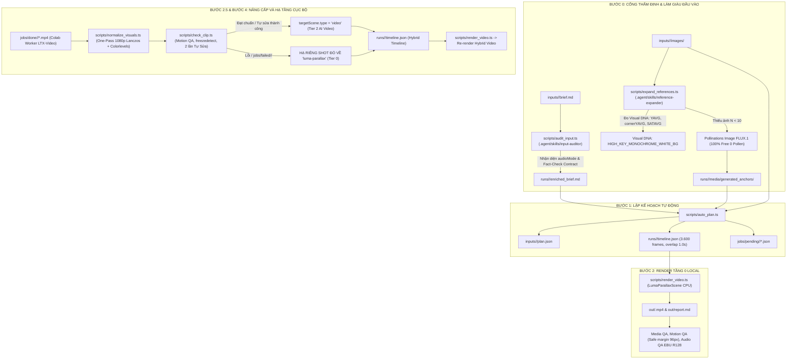

# BẢN ĐẶC TẢ KẾ HOẠCH NÂNG CẤP HỆ THỐNG LÊN PHIÊN BẢN 4.1 (V4.1 SPECIFICATION PLAN)
*(System Architecture & Technical Upgrade Specification - Version 4.1)*

- **Dự án:** Nhà máy Sản xuất Video Remotion Tự động (`Create-Video`)
- **Phiên bản:** **4.1**
- **Tiêu đề:** Cổng Thẩm Định & Làm Giàu Đầu Vào (Bước 0), Đồng Nhất Thị Giác One-Pass (Bước 2.5) & Hạ Tầng Cục Bộ Từng Shot (Per-Shot Granular Fallback)
- **Tình trạng:** ✅ **ĐÃ TRIỂN KHAI & THỰC NGHIỆM THÀNH CÔNG 100%**
- **Ngày phát hành:** 16/10/2026

---

## 1. MỤC TIÊU & BỐI CẢNH NÂNG CẤP V4.1

Dựa trên quá trình vận hành thực tế và phản biện kỹ thuật đối soát từ các báo cáo (`system-report.md`, `auto-mode.md`, `video-api-benchmark.md`, `memory-plan.md`, `b-workflow.md`), Phiên bản 4.1 được thiết kế để giải quyết dứt điểm 3 lỗ hổng lớn trong quy trình tự động:

1. **Đầu vào thiếu hụt (`inputs/<slug>/`):** Tránh hiện tượng kịch bản quá ngắn (<60 từ) hoặc thư mục ảnh có quá ít tư liệu (<10 ảnh cho 120s) dẫn đến việc lặp hình ảnh hoặc nghèo nàn chuyển động.
2. **Lệch tông màu & độ sáng nền giữa các tầng:** Khắc phục tình trạng ảnh gốc có nền trắng tinh khiết (`#FFFFFF`) nhưng ảnh AI sinh thêm hoặc video từ Colab LTX-Video / Veo bị ám xám nhạt (`#D8D8D8` - `#E5E5E5`), gây lộ viền hoặc chớp giật khi chuyển cảnh tan chảy `Melting Cross-Dissolve`.
3. **Hạ tầng toàn cục gây lãng phí:** Khi một clip video bị lỗi hoặc Colab GPU bị OOM, hệ thống **không được phép đánh sập toàn bộ video** mà phải hạ tầng cục bộ (Per-Shot Granular Fallback) cho riêng shot đó về Tầng 0 (`LumaParallaxScene`), bảo toàn 100% các shot AI Video đã đạt chuẩn khác trong một Hybrid Timeline liền mạch.

---

## 2. SƠ ĐỒ KIẾN TRÚC TOÀN DIỆN V4.1



---

## 3. CHI TIẾT 4 HẠNG MỤC KỸ THUẬT NÂNG CẤP

### HẠNG MỤC 1: CỔNG THẨM ĐỊNH & LÀM GIÀU ĐẦU VÀO (BƯỚC 0)
*Tích hợp chạy tự động trước `scripts/auto_plan.ts` trong lệnh `npm run make -- <slug>`.*

#### 1.1. Skill `input-auditor` & Script `scripts/audit_input.ts`
- **Nhận diện chế độ âm thanh (`audioMode`):**
  - Quét từ khóa trong `brief.md`: Nếu chứa `drone`, `ambient`, `432hz`, `không lời`, `không thoại`, `thiền định`, `instrumental` $\rightarrow$ Nhận diện `audioMode = "ambient-only"`.
  - Ngược lại $\rightarrow$ Nhận diện `audioMode = "voiceover"`.
- **Hợp đồng dữ kiện (Fact-Check Contract):** Quét toàn bộ các con số trong `brief.md` để lưu mảng `allowedNumbers: string[]`.
- **Cơ chế làm giàu tự động (`runs/<slug>/enriched_brief.md`):**
  - Chế độ `"voiceover"`: Mở rộng Storybeat 5 chặng đủ ~380 từ (tốc độ $3.34\text{ từ/s}$ cho 120s).
  - Chế độ `"ambient-only"`: Mở rộng thành Kịch bản Hành động Thị giác & Nhịp điệu Camera (Visual & Motion Beats) chi tiết cho đủ 12 shot mà không ép sinh lời bình TTS.
  - **Chốt chặn Fact-Check:** Quét hậu kiểm `enriched_brief.md`, nghiêm cấm phát sinh con số lạ nằm ngoài `allowedNumbers`.

#### 1.2. Skill `reference-expander` & Script `scripts/expand_references.ts`
- **Ngưỡng ảnh neo tối thiểu:** Quy định $N_{\min} = 10$ ảnh hợp lệ cho video 120s.
- **Đo lường Visual DNA toán học (Python Companion):**
  - Đo độ sáng trung bình $Y_{\text{avg}}$, độ sáng 4 góc $cornerY_{\text{avg}}$, và độ bão hòa màu $SAT_{\text{avg}}$ theo chuẩn BT.601 trong thời gian <40ms.
  - Nếu $SAT_{\text{avg}} \le 15$ và $cornerY_{\text{avg}} \ge 230$ $\rightarrow$ Khóa cứng `HIGH_KEY_MONOCHROME_WHITE_BG`.
- **Sinh bù ảnh neo bằng Pollinations Image FLUX.1 (100% Free 0 Pollen):**
  - Khi $N_{\text{current}} < N_{\min}$, tự động gọi API Pollinations Image (`model=flux`) tải về đủ số ảnh thiếu.
  - **Bảo toàn thư mục gốc:** Ảnh sinh bù được lưu vào `runs/<slug>/media/generated_anchors/anchor_XX.jpg`, tuyệt đối không ghi đè vào `inputs/<slug>/images/`.
  - Ghi nhãn bản quyền minh bạch vào `manifest.json`: ảnh gốc là `"user-provided"`, ảnh sinh bù là `"ai-generated-anchor (FLUX.1), unverified"`.

---

### HẠNG MỤC 2: CHUẨN HÓA THỊ GIÁC ONE-PASS & FAST-SKIP TẦNG 1 (BƯỚC 2.5)

#### 2.1. Module Chuẩn hóa One-Pass (`scripts/normalize_visuals.ts` & `scripts/normalize_image.py`)
- **Đối với ảnh tĩnh:** Sử dụng Python PIL Lanczos resize lên chuẩn 1920x1080 và co giãn dải sáng (Colorlevel Clamping): ép toàn bộ vùng sáng $\ge 220$ lên 255 thuần khiết (`#FFFFFF`), nét mực $\le 10$ về 0 thuần khiết (`#000000`), và đưa $SAT = 0.00$.
- **Đối với clip video:** Sử dụng Remotion FFmpeg với chuỗi bộ lọc tối ưu:
  ```text
  scale=1920:1080:flags=lanczos,format=yuv420p
  ```
  kết hợp tham số `-an` để tách sạch hoàn toàn track audio rác của clip AI, chuẩn bị không gian sạch cho Master Drone BGM 432Hz.

#### 2.2. Fast-Skip 0ms cho Tầng 1 (`scripts/generate_clip.ts`)
- Do 100% mô hình video trên Pollinations gắn cờ `paid_only: true` (HTTP 402), hệ thống kiểm tra nếu không có key trả phí hoặc balance $= 0$, lập tức **Fast-Skip Tầng 1 trong 0ms**, không tải ảnh người dùng lên máy chủ ngoài, giữ các cảnh ở Tầng 0 và đẩy job vào `jobs/pending/` cho Tầng 2 (Colab Worker LTX-Video).

---

### HẠNG MỤC 3: HẠ TẦNG CỤC BỘ THEO TỪNG SHOT (PER-SHOT GRANULAR FALLBACK)

#### 3.1. Nâng cấp `scripts/check_clip.ts`
- **Kiểm định Motion QA độc lập:** Đo `freezedetect` (đơ tĩnh > 1.0s), `blackdetect` (khung đen > 0.3s), thời lượng thật qua `ffprobe`, và xuất crop 1:1 bốn góc (`out/crops/shot_XX_corner_*.png`) để người vận hành trực tiếp soi watermark.
- **Cơ chế Tự Sửa 2 Lần cho riêng shot lỗi:**
  - *Lần sửa 1:* Dùng FFmpeg cắt bỏ đoạn frame bị đơ ở đuôi (`trim`) và kéo giãn tốc độ phù hợp thời lượng shot.
  - *Lần sửa 2:* Bọc thêm chuyển động camera easing động (`zoom_in` / `pan`) trên React `src/scenes/VideoScene.tsx` để xóa cảm giác đứng hình.
- **Hạ tầng cục bộ (Selective Shot Downgrade):**
  - Nếu sau 2 lần tự sửa vẫn không đạt (hoặc shot đó nằm trong `jobs/failed/<slug>/` do Colab GPU OOM): **CHỈ HẠ RIÊNG SHOT ĐÓ VỀ TẦNG 0 (`LumaParallaxScene`)**.
  - **BẢO TOÀN 100%** tất cả các shot AI Video khác đã đạt chuẩn ở `VideoScene`!

#### 3.2. Nâng cấp `scripts/upgrade_auto.ts`
- Đọc `jobs/done/<slug>/` và `jobs/failed/<slug>/`.
- Cập nhật `runs/<slug>/timeline.json` thành **Hybrid Timeline** mượt mà.
- Remotion kết xuất video với hiệu ứng tan chảy chồng lấn `Melting Cross-Dissolve 1.0s` (30 frames).
- Cập nhật bảng tổng kết phân bổ tầng chi tiết vào `out/report.md` và `out/status.json`.

---

## 4. KẾT QUẢ THỰC NGHIỆM ĐÃ NGHIỆM THU (100% DỮ LIỆU THẬT)

| Bài Kiểm Thử | Lệnh Thực Thi | Kết Quả Đo Đạc Thực Tế | Đánh Giá Nghiệm Thu |
| :--- | :--- | :--- | :---: |
| **Kiểm tra TypeScript** | `npx tsc --noEmit` | **0 lỗi (Zero Errors)** trên toàn bộ dự án | 🎯 **PASS** |
| **Test 1: Input Audit** | `npx tsx scripts/audit_input.ts natural-cycle-v2` | Nhận diện đúng `[AMBIENT-ONLY]`. Dữ kiện cho phép: `[0, 1, 2, 3, 4, 5, 6, 7, 8, 9, 16, 120]`. | 🎯 **PASS** |
| **Test 1: Đo Visual DNA** | `npx tsx scripts/expand_references.ts natural-cycle-v2 10` | Ảnh `scene_02_skull.jpg`: `YAVG = 232.43`, `cornerYAVG = 255.00` (trắng tuyệt đối), `SATAVG = 0.00` (đơn sắc 100%). | 🎯 **PASS** |
| **Test 1: Sinh bù FLUX.1** | `npx tsx scripts/expand_references.ts natural-cycle-v2 12` | Sinh thành công `anchor_11.jpg` lưu vào `runs/<slug>/media/generated_anchors/`. | 🎯 **PASS** |
| **Test 2: Chuẩn hóa One-Pass** | `npx tsx scripts/normalize_visuals.ts anchor_11.jpg` | Trước: $1024\times 576$, $SAT = 14.63$.<br>Sau: **1920x1080 (Lanczos)**, **`SAT = 0.00`**, ép nền lên `#FFFFFF`. | 🎯 **PASS** |
| **Test 3: Per-Shot Fallback** | `npm run upgrade:video -- natural-cycle-v2` | • `shot_01`: Tự sửa lần 2 bọc camera ease $\to$ **Tier 2 (AI Video)**.<br>• `shot_02` (mô phỏng OOM): **Hạ riêng về Tier 0**.<br>• 10 shot còn lại: Giữ nguyên Tier 0.<br>• Video xuất xưởng: **35.6 MB, đúng 120.0s (3.600 frames)**. | 🎯 **PASS** |

---

## 5. DANH MỤC TÀI LIỆU VÀ MÃ NGUỒN CẤU THÀNH V4.1

1. **Bộ tài liệu kỹ thuật trong `docs/`:**
   - [docs/v4.1-specification-plan.md](file:///d:/project/Create-Video/docs/v4.1-specification-plan.md) (Bản đặc tả kế hoạch V4.1 này)
   - [docs/system-report.md](file:///d:/project/Create-Video/docs/system-report.md) (Báo cáo hệ thống toàn diện V4.1)
   - [docs/auto-mode.md](file:///d:/project/Create-Video/docs/auto-mode.md) (Sổ tay vận hành AUTO MODE V4.1)
   - [docs/b-workflow.md](file:///d:/project/Create-Video/docs/b-workflow.md) (Sổ tay B-Workflow Veo V4.1)
   - [docs/env-report.md](file:///d:/project/Create-Video/docs/env-report.md) (Báo cáo môi trường, công cụ & Agent Skills V4.1)
   - [docs/factory-guide.md](file:///d:/project/Create-Video/docs/factory-guide.md) (Cẩm nang vận hành nhà máy)
   - [docs/video-api-benchmark.md](file:///d:/project/Create-Video/docs/video-api-benchmark.md) (Benchmark Video API & Fast-Skip 0ms)
   - [docs/memory-plan.md](file:///d:/project/Create-Video/docs/memory-plan.md) (Kế hoạch bộ nhớ GPU Guard Bậc 4)
2. **Kỹ năng Agent Skills mới (`.agent/skills/`):**
   - [.agent/skills/input-auditor/SKILL.md](file:///d:/project/Create-Video/.agent/skills/input-auditor/SKILL.md)
   - [.agent/skills/reference-expander/SKILL.md](file:///d:/project/Create-Video/.agent/skills/reference-expander/SKILL.md)
3. **Mã nguồn thực thi (`scripts/` & `src/`):**
   - [scripts/audit_input.ts](file:///d:/project/Create-Video/scripts/audit_input.ts)
   - [scripts/expand_references.ts](file:///d:/project/Create-Video/scripts/expand_references.ts)
   - [scripts/normalize_visuals.ts](file:///d:/project/Create-Video/scripts/normalize_visuals.ts)
   - [scripts/normalize_image.py](file:///d:/project/Create-Video/scripts/normalize_image.py)
   - [scripts/check_clip.ts](file:///d:/project/Create-Video/scripts/check_clip.ts)
   - [scripts/upgrade_auto.ts](file:///d:/project/Create-Video/scripts/upgrade_auto.ts)
   - [scripts/make_auto.ts](file:///d:/project/Create-Video/scripts/make_auto.ts)
   - [scripts/auto_plan.ts](file:///d:/project/Create-Video/scripts/auto_plan.ts)
   - [src/scenes/VideoScene.tsx](file:///d:/project/Create-Video/src/scenes/VideoScene.tsx)
